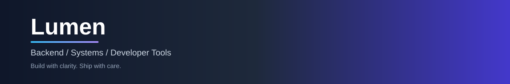

<!-- Banner：托管在仓库内，不依赖 Vercel -->

<!-- 访问计数 -->

  

## 你好 👋，我是 Lumen

  一名热爱写代码的开发者，关注 <b>后端工程</b>、<b>系统设计</b> 与 <b>开发效率</b>。 
  相信好的代码应该清晰、可靠、易于演进。

---

### 🧑‍💻 关于我

- 🔭 日常与 **Go / Linux / 数据库 / 分布式系统** 打交道
- 🌱 持续学习，乐于分享与实践
- 💡 喜欢用清晰的架构解决实际问题
- ⚡ 重视可读性、可维护性与工程化思维
- 📫 欢迎通过 GitHub 与我交流

---

### 🛠 语言与工具

  
  
  
  
  
  
  
  

---

### 📫 联系我

  
  

---

### 📊 GitHub 统计

<!-- 由 GitHub Actions 生成并托管，国内访问更稳定 -->

  
  &nbsp;&nbsp;
  

  

---

### 🐍 贡献轨迹

  

---

### 📈 贡献活动

  

---

  <i>保持好奇，踏实构建。</i>

