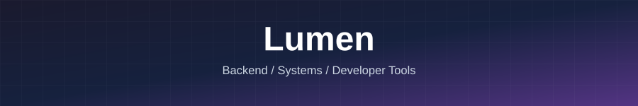
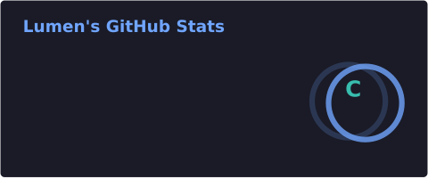
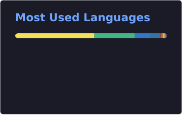
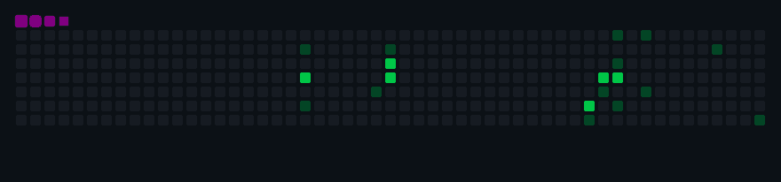
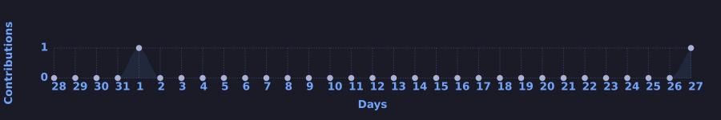

<!-- 使用相对路径 + PNG/GIF，GitHub 渲染最稳定 -->

## 你好 👋，我是 Lumen

> 开发者 · 后端工程 · 系统设计 · 开发效率

一名热爱写代码的开发者，关注 **后端工程**、**系统设计** 与 **开发效率**。

---

### 🧑‍💻 关于我

| | |
|:---:|:---|
| 🔭 | 日常与 **Go / Linux / 数据库 / 分布式系统** 打交道 |
| 🌱 | 持续学习，乐于分享与实践 |
| 💡 | 喜欢用清晰的架构解决实际问题 |
| ⚡ | 重视可读性、可维护性与工程化思维 |
| 📫 | 欢迎通过 GitHub 与我交流 |

---

### 🛠 语言与工具

---

### 📫 联系我

---

### 📊 GitHub 统计

  
  

  

---

### 🐍 贡献轨迹

  

---

### 📈 贡献活动

  

---

<i>保持好奇，踏实构建。</i>

