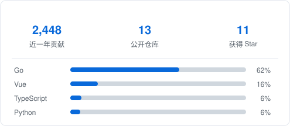

<h1 align="center">你好，我是 Achieve 👋</h1>

<b>大模型应用开发（Agent / RAG）</b> · 后端工程 · 杭州

  
  

  
  
  
  
  
  
  
  
  

---

## 关于我

做**大模型应用开发**与**后端工程**：Agent 编排、RAG 检索与评测、大模型工程化（网关 / 路由 / 观测），以及 Go / Java 服务端架构。

喜欢把复杂的东西收敛成一个干净接口，也喜欢把踩过的坑变成能直接用的工具。

## 技术能力

| 方向 | 内容 |
|---|---|
| AI 应用 | LangGraph 多 Agent 编排、ReAct、Planner-Executor-Reviewer、意图槽位治理、多轮任务会话、工具调用编排、vLLM 部署 |
| RAG | 文档解析路由、父子块切分、向量 + 全文 + 知识图谱三路召回、RRF 融合、LLM-as-Judge 评测与 badcase 回流 |
| 后端 | Go / Java / Python；Spring Boot、MyBatis-Plus、Dubbo、FastAPI；分布式事务、分布式锁、线程池与异步编排 |
| 中间件与存储 | MySQL（索引 / 事务 / MVCC / 分库分表）、Redis、Elasticsearch、RabbitMQ、RocketMQ、MQTT、Mycat |
| 工程与运维 | Docker、Nginx、Linux、Langfuse 全链路观测、Arthas 线上排查、CI/CD |
| 前端 | Vue、React、Umi、Element Plus、Ant Design、ECharts |

## 开源 / 个人项目

| 项目 | 说明 |
|---|---|
| [llm-gateway](https://github.com/achieve-jsy/llm-gateway) | 统一大模型网关：OpenAI 兼容入口 + 多厂商模型组调度 + 管理台（Go + Vue3） |
| [lan-proxy-gateway](https://github.com/achieve-jsy/lan-proxy-gateway) | 把一台电脑变成整屋的代理网关：mihomo / TUN / 链式代理（Go） |
| [mac_desk_arrangement](https://github.com/achieve-jsy/mac_desk_arrangement) | macOS 多显示器窗口布局管理，一键排列与快照恢复（Tauri + Rust） |
| [monitor_bian](https://github.com/achieve-jsy/monitor_bian) | 币圈合约持仓监控终端（Rust TUI） |
| [nba2kol2_script](https://github.com/achieve-jsy/nba2kol2_script) | NBA 2KOL2 自动化脚本 |

## GitHub 数据

  

  

---

<i>保持好奇，保持简单。</i>

